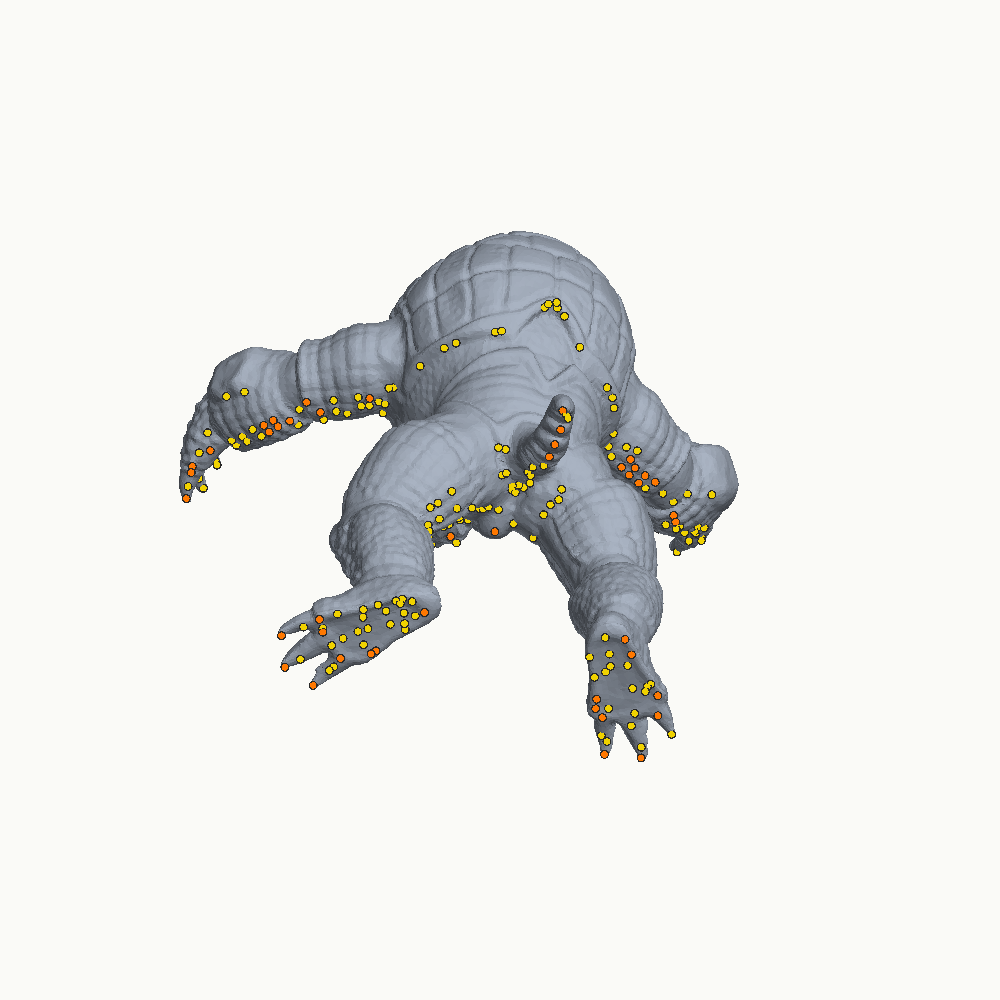
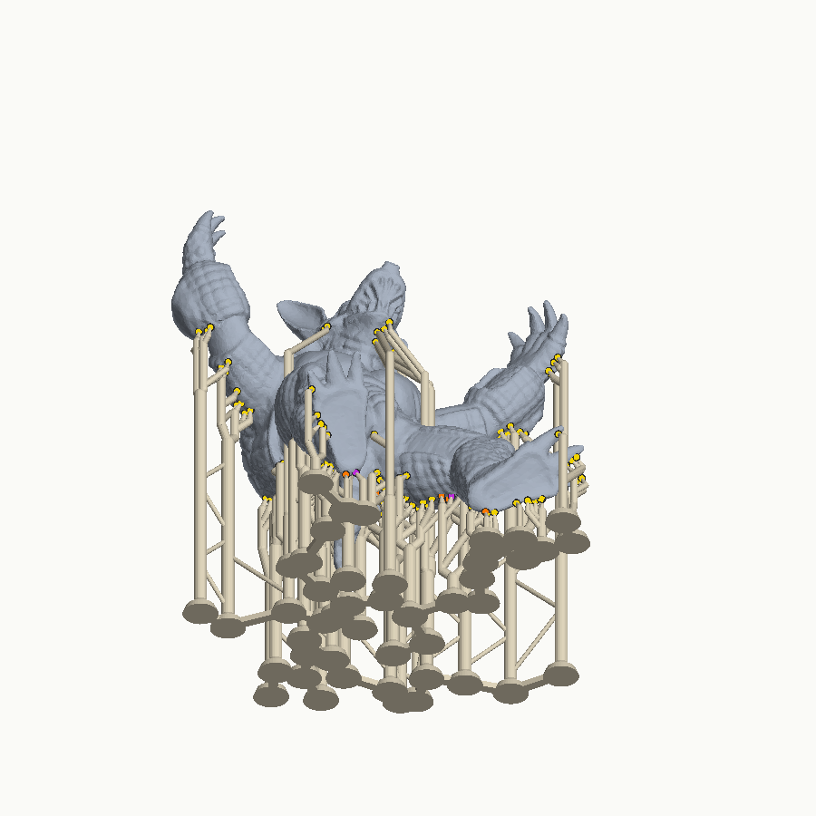

# FruitSlicer

Resin (MSLA) support generator, targeting the **Elegoo Saturn 4 Ultra 16K**
(15120×6230 px, 14×19 µm pixels, tilt release).

Goals: supports that leave small, well-placed marks, come off easily, and use
as few contact points as the print physically allows. The design, the research
behind it, and the milestone plan are in
[`docs/resin-support-plan.md`](docs/resin-support-plan.md).

## Status

| Milestone | State |
|---|---|
| M0 — foundation: STL I/O, nonzero mesh slicer, mesh minima/thickness, island graph, printer profile, overlap coupon | done |
| M0.5 — calibration plates (tips, spacing, islands) with manifests and result sheets | done |
| M1 — support-point generator (coverage through material + capacity + islands), points JSON with persistent manual edits, preview renderer | done (calibration still needed) |
| M2 — heads (collision-aware), pillars with 45° bridges and diagonal ground routes, bracing outside the flex zone, one-piece pad raft, model+supports STL, floating-island validation | phase 1 done |
| M3 — orientation search (two-stage: mesh proxies over 64 directions, full generator on the 6 best) | done |
| M5 (part) — branching: nearby pillars merge into trunks below the flex zone | done |
| Calibration loop: `fit` result sheets → resin profile → `--profile` | done |
| Safety: suction-cup / resin-trap warnings, no supports in closed cavities, no-trap bracing, hinge bias, on-plate mode | done |
| Same-plate A/B helper for the go/no-go (`abplate`) | done |
| Physical validation: overlap coupon, calibration plates, A/B plate | **needs your printer** |
| Native `.goo` writer/reader (`goo`, `goo-info`, `goo-compare`, orientation coupon) | done; header verified against SatelLite 1.0.2.43's 16K file; image orientation pending the F comparison |
| macOS (Apple Silicon) build in CI | done |
| Desktop app for macOS: open and check, orient, supports, layers, save a checked `.goo` | early build, downloadable from CI; calibration and hollowing next |
| Grey-level tips (weaker contacts, smaller marks) | next |

## Build

Requires CMake ≥ 3.24 and a C++20 compiler (GCC 12+, Clang 15+, or Apple
Clang from current Xcode command line tools; CI builds on Ubuntu and on
macOS/Apple Silicon). Dependencies
(Clipper2, CLI11, nlohmann/json, Catch2) are fetched by CMake.

```sh
cmake -S . -B build -G Ninja -DCMAKE_BUILD_TYPE=Release
cmake --build build
ctest --test-dir build
```

## Desktop app (early build)

A Mac app is being built in stages on top of the same engine. Today it
opens STL, OBJ and 3MF files and checks them: closed shells, inside-out
parts, hollows, low points, and whether the model fits the Saturn 4 Ultra
16K's plate. You then choose its size (full, the largest that fits, a custom
percentage, or ×25.4 for models drawn in inches), rotation, and whether it
stands raised on supports or flat on the plate. Edits undo with ⌘Z, and ⌘/
lists the shortcuts. **⌘S saves the job** (a `.fruitjob` file): the model's
own copy, how it is placed and stands, the support settings and tips, and
the print settings (with the SatelLite file's header, if one gave them).
Opening a job brings its supports back as they were. Home lists recent
jobs; if a job's model file has moved, the job still opens from its copy
(or you point it at the file). Closing or opening something else asks
first when there are unsaved changes. The Orient step scores how the model sits (tips, island
tips, biggest layer, height, layers short of hold), lets you pick the sides
people will see, and searches 65 directions for better ways to stand it,
compared side by side with how it sits now; using one is undoable. The
Supports step generates tips and the support tree with the usual tip size,
spacing and trunk merging you choose (faces that need tips are tinted
first), shows the run's stages with Cancel, and then the tree in 3D with
three views (Supports, Tips only, Why), why any tip you click is there, the
checks (nothing starts in mid-air, the raft comes off in one piece, no
support stands on the model) and a drawer of things to review. Changing
the model afterwards marks the supports out of date. **Edit tips by hand**
adds tips where you click the model, moves (drag), deletes, resizes and pins
them, and draws no-tip zones. Every edit is listed and can be undone on its
own (changing a tip of your own changes the edit that made it), is kept in
the model's own coordinates and is saved with the job. An edit applies on top
of the planner's tips straight away; when the tips are planned again
(regenerating, or after turning the model) the planner works around your
tips and keeps its own out of the zones, including the 1.8 mm one a deleted
tip leaves. **Advanced settings**
lists every value the tip planner and the tree builder use (29 rows, from
tip sizes and how much a tip holds to braces and the raft) with where each
comes from: built in, borrowed from PrusaSlicer until you calibrate, or an
assumption not measured yet. You can change them; your values are marked,
stay with you for the next model, and **Reset all** brings back
FruitSlicer's own. The Layers step cuts
the model and its supports into the printer's layers and shows any of them
at the printer's own pixel shape (14 × 19 µm), with the layer below, the
area of every layer by height, and checks on the whole print (nothing in
mid-air, suction cups and resin traps); ↑ ↓, Page Up/Down and Home/End move
through the layers. The Print step checks the job before saving (nothing in
mid-air, model and supports inside the build volume, a raft at least as
thick as the bottom and transition layers) and takes exposure and motion
settings from a `.goo` that SatelLite saved for your printer, or exposure
times you type. It shows the print time, resin and layer count. **Save
.goo** writes to a USB drive it finds, or a folder you choose; if your
SatelLite file uses another layer height, the layers are cut again at that
height so the exposures fit. Then it reads the whole file back: every
layer's checksum, no grey pixels, and the decoded volume against what was
written. The drive can be ejected from the app, and **Export STL** writes
the model with its supports for another slicer. Until the image-orientation
check has confirmed it, the app asks once per launch before saving, because
a wrong guess prints mirrored.

**Calibrate** holds the printer checks. The **image orientation check** takes
five minutes and no resin: save the F test piece (`f.stl`), slice it in
SatelLite as it is, and choose SatelLite's `.goo`. FruitSlicer slices the same
F with that file's settings, lines up the two images, shows them side by side
with how well each flip overlaps, and **Use this for my printer** applies the
fix to every print file from then on (the warnings then go away). The
**Printer** page shows the printer, the orientation in use and the side the
tilting vat hinges on; once the orientation is confirmed, supports get up to
+25 % hold on the side away from the hinge. Both are kept between launches in
`settings.json` in the app's data folder.

The first launch runs **setup**: the printer, the print settings of the resin
new jobs start with (from a SatelLite `.goo`, whose header FruitSlicer keeps a
copy of, or exposures typed in), the image orientation check, and calibration
now or later. A `.goo` made for another printer is refused, with the reason,
here and on the Print step. **Resins** keeps a library: each resin's print
settings and the support values measured for it, imported from a profile that
`fruitslicer fit` wrote, each shown as measured, borrowed or FruitSlicer's own.
A job is printed in one resin (the chip at the top of the job switches it) and
keeps its own copy of that resin's values, so changing the resin later never
changes a saved job; switching makes the supports out of date. Tip sizes are
matched by diameter, so a profile that measured other sizes still means what
you chose. **Settings** (at the bottom of the rail) has the 3D view's
smoothing, how many processor cores slicing and saving may use, whether `.goo`
files go to a plugged-in USB drive, the resin for new jobs, the log file, and
**Run setup again**; FruitSlicer sends no usage data. **About** says
what has been checked and what not yet, and has the full licence text of
FruitSlicer and of every library and the typeface built into the app. It is
one universal app for Apple silicon and Intel Macs, macOS 14 or later.

**Download.** Every CI run builds it. On GitHub, open the run (a pull
request's *Checks* tab, or *Actions* → **CI**), scroll to *Artifacts*, and
download **FruitSlicer-macOS.zip**. Unzip it and move `FruitSlicer.app` to
Applications.

**First launch.** The app is signed ad hoc, not with an Apple Developer ID,
so macOS blocks it the first time:

1. Double-click FruitSlicer. macOS says it could not verify the app; click
   **Done**.
2. Within about an hour, open **System Settings → Privacy & Security**,
   scroll to **Security**, and click **Open Anyway** next to the FruitSlicer
   message.
3. Confirm with your login password. From then on it opens normally.

Since macOS 15, Control-click → Open no longer skips these steps. Each newly
downloaded build is checked again, so expect to repeat them after updating.
(For builds from this repository's CI only, `xattr -dr com.apple.quarantine
/Applications/FruitSlicer.app` in Terminal skips the check instead.)

**Building it yourself** (Xcode command-line tools, CMake and Ninja):

```sh
cmake -S . -B build-app -G Ninja -DCMAKE_BUILD_TYPE=Release -DFRUIT_BUILD_APP=ON
cmake --build build-app --target fruitslicer_app
open build-app/src/gui/FruitSlicer.app
```

On Linux the same commands build `build-app/src/gui/fruitslicer_app` (X11),
which CI uses for screenshot tests.

**If something looks wrong:** *About* lists the graphics driver and display
scale, and the log is `~/Library/Application Support/FruitSlicer/fruitslicer.log`.
`/Applications/FruitSlicer.app/Contents/MacOS/FruitSlicer --self-test-gl`, run
in Terminal, checks the engine, the fonts and OpenGL without the interface.

**Screenshot tests.** The scripts in `tests/gui/*.json` drive the app
through the same commands as its buttons (`--script s.json --shots dir`; the
steps are listed in `src/gui/Script.h`), and CI compares the pictures with
`tests/gui/golden` using `tools/compare_screens.py`. A run also fails when
Dear ImGui reports a misuse. After an intended visual change, check the new
pictures (CI uploads them as *app-screens-linux*) and copy them over the
goldens. The app's document logic has its own tests (`fruit_gui_tests`).

## Usage

Every command reads STL (binary or text), OBJ and 3MF models.

```sh
# Mesh statistics: shells, manifoldness, volume, downward-facing minima
./build/src/fruitslicer info model.stl

# Place (rotate, centre, lift 5 mm), slice at 0.05 mm, report islands; optional debug PNGs
./build/src/fruitslicer slice model.stl --rotate 30 0 0 --elevate 5 --layer 0.05 \
    --png-dir out/layers --every 20 --json out/report.json

# Week-1 compatibility test: overlapping shells (see below)
./build/src/fruitslicer coupon overlap -o overlap_coupon.stl --png-dir out/overlap_ref
```

### Calibration plates

The support generator's limits (how much area a tip of each size holds, how
far apart tips can be, how many tips an island needs, the self-supporting
angle) depend on your resin and printer, and no vendor publishes them. Three
plates measure them:

```sh
./build/src/fruitslicer calibrate tips    -o tips.stl     # tip diameter × penetration × load
./build/src/fruitslicer calibrate spacing -o spacing.stl  # tilted plates × tip pitch, plus wedges
./build/src/fruitslicer calibrate islands -o islands.stl  # island size × number of tips
```

Each writes `<name>.stl.json` (which cell holds which parameters) and
`<name>.stl.results.csv` (one row per coupon to fill in). Every coupon sits on
its own small raft in a grid; the L-shaped marker in the corner cell shows
which way the rows and columns run. Parameter combinations are shuffled over
the plate with a fixed seed, so position on the plate does not line up with
any one parameter.

### Support points

```sh
./build/src/fruitslicer points model.stl --rotate 30 0 0 -o points.json --report report.json
./build/src/fruitslicer render model.stl --rotate 30 0 0 --points points.json -o preview.png
```



*Armadillo seen from below: island tips orange, overhang tips yellow.*

Points are chosen bottom-up so that

1. **coverage**: every surface that leans more than 45° from vertical has a tip
   within a radius that grows with the cured height above the tip (seeded with
   PrusaSlicer's curve, 3.2 mm → 6 mm), measured *through material*, so a tip
   never "covers" across a slot or onto a neighbouring finger;
2. **capacity**: for every connected piece at every layer, its tips together
   can hold its cross-section under peel (seed: one 0.4 mm tip per 11.1 mm²,
   scaled by tip area);
3. **islands**: every island gets 1 tip (≤ 1.7 mm), 2 tips (≤ 6.5 mm) or at
   least 3, using the mesh minimum as the contact. Islands too small to hold a
   tip that join the model almost at once are left alone and reported.

Placement is a cost-weighted greedy set cover (cosmetic keep-out regions and
sharp edges cost more), followed by pruning that re-checks coverage and
capacity. On real meshes the greedy cover saves only 1–8 % of points over the
simpler "every uncovered sample becomes a tip" rule. The settings that move
the count much more are the coverage radius, the critical angle and the
orientation, which is why calibration and the orientation search come next.

Manual edits persist across regeneration:

```sh
# edits.json: {"add": [{"pos": [x,y,z], "tip_diameter": 0.3}], "delete": [<id>], "move": [...], "resize": [...]}
./build/src/fruitslicer points model.stl --points-in points.json --edits edits.json -o points2.json
```

Cosmetic regions (`--cosmetic cosmetic.json`) make tips avoid boxes or faces
visible from given directions:
`{"keep_out": [{"min": [x,y,z], "max": [x,y,z]}], "visible_from": [[0,-1,0]]}`.

### Orientation

```sh
./build/src/fruitslicer orient model.stl --visible-from 0 -1 0 --preview-dir out/orient
```

The search tries the input orientation and 64 build directions spread over a
sphere. Each is first scored with cheap mesh measures: area that needs
support, number of downward minima (islands), peak layer area, height, and
area needing support on faces visible from the `--visible-from` directions
(given in the model's own frame). The six best, plus the input orientation,
then go through the real point generator. The command prints the best
`--rotate` values next to the input orientation's numbers.

| Model | Points (input → best) | Peak layer area | Island tips |
|---|---|---|---|
| Armadillo | 239 → 204 (−15 %) | 750 → 551 mm² | 33 → 10 |
| Stanford bunny | 214 → 177 (−17 %) | 842 → 690 mm² | 62 → 61 |

Each search takes about 30 s at 0.1 mm evaluation layers.

### Supports and printable file

```sh
./build/src/fruitslicer support model.stl --rotate 30 0 0 -o supported.stl \
    --preview preview.png --report report.json
```

This writes the model and its supports as one STL to load into Elegoo
SatelLite or CHITUBOX for slicing. The points used are saved next to it
(`supported.stl.points.json`); edit them and pass them back with `--points`.
A points file records the placement it was made for: without `--rotate`,
`--elevate` or `--scale`, `support --points` uses that placement; a different
one is refused, since the points would no longer touch the model.
Each point gets:

- a pinhead pointing along the surface normal, tilted at most 45° from
  vertical. Its direction is searched when the default one would hit the
  model; the check uses rays along the cone, so walls are seen but the
  surface under the tip is not;
- a vertical pillar to the raft. Up to three heads share one pillar through
  45° bridges. A head with no clear vertical drop walks diagonally outwards
  until it finds one, and only as a last resort stands on the model; that
  case is reported because it marks an upper surface;
- bracing between tall pillars, kept out of the 2 mm flex zone below the
  heads so the tips bend and snap off at the part;
- branching: pillars within 8 mm merge where 45° branches from each meet,
  below the flex zone and below any bridge already on them. The trunk's
  cross-section is the sum of the two, and at most 6 tips share one trunk.
  On the armadillo this cut trunks reaching the raft from 82 to 47 and braces
  from 189 to 35 (`--no-merge` turns it off);
- a pad under each trunk, the pads joined by flat bars, so the raft and
  supports come off as one piece.

The report re-slices model plus supports and lists anything that would still
start printing in mid-air (`validation.floating_islands`, which should be 0).

Safety checks and options:

- **Suction cups and resin traps.** Hollows closed towards the plate but open
  towards the film are cups, and each peel pulls a vacuum through them.
  Fully closed hollows are traps. Both are reported with their height range
  and volume. Tips are never placed on the ceiling of a closed cavity, since
  they could not be removed.
- **No-trap bracing.** Two trunks are never braced when model material passes
  between them below the braces. The pillars, brace and raft would form a
  loop around it, and the supports could not come off (PrusaSlicer #14594).
- **`--hinge ±x|±y`.** Tells FruitSlicer which side of the plate the tilting
  vat's hinge is on. Peel stress is highest on the far side (Wu 2016), so tips
  there carry extra demand (`--peel-bias`, default 0.25; the right value is
  unmeasured).
- **`--on-plate`.** Prints flat-backed parts standing on the build plate, with
  no elevation and no raft. The base is held by the plate, so only overhangs
  get tips.



### From printed plates to a resin profile

After printing the plates, fill in the `result` column (`ok`, `failed` or
`partial`) and, for the tips plate, the `scar` column (1 = invisible …
5 = pit). Leave `scar` empty or 0 when not scored. Then:

```sh
./build/src/fruitslicer fit tips.stl.results.csv spacing.stl.results.csv islands.stl.results.csv \
    --resin "My resin" --layer 0.05 --exposure 2.5 --temp 30 -o my_resin.json
./build/src/fruitslicer support model.stl --profile my_resin.json -o supported.stl
```

`fit` estimates the following:

- **from the tips plate:** how much layer area each tip size holds (70 % of
  the load at which half the tips fail), the best penetration for each size,
  and a default tip (the lowest scar score among tips that hold at least
  4 mm²);
- **from the spacing plate:** the coverage radius (the widest tip pitch that
  held at every angle, divided by √2) and the critical overhang angle;
- **from the islands plate:** how large an island one or two tips can hold.

Estimates resting on incomplete data (nothing failed, or nothing held) are
listed under `notes` in the profile, so a bound is never mistaken for a
measurement. `--profile` works with `points`, `support` and `orient`, and
explicit command-line options still override it.

### Go/no-go: same-plate comparison with SatelLite

```sh
./build/src/fruitslicer abplate model.stl --copies 8 --profile my_resin.json -o ab
```

This writes `ab_A.stl` (copies with FruitSlicer supports, plus an L marker in
the corner cell) and `ab_B.stl` (bare copies). Import both into SatelLite,
add its auto-supports to the B copies only, and print them together. Which
grid cell gets which arm is shuffled with a fixed seed (`ab.json`). Record
each copy in `ab.results.csv`:

- result: ok / failed / partial;
- scar, 1–5, judged blind under raking light;
- seconds to remove the supports.

Count each arm's support contacts in the slicer. The plan's bar is: at the
same failure rate, at least 25 % fewer contacts or visibly smaller marks.

### Printing with FruitSlicer's own `.goo`

FruitSlicer writes Elegoo's `.goo` print files directly, so SatelLite is no
longer needed in the loop. The easiest way to get your exposure settings
right is to copy them from any file SatelLite exported for your printer:

```sh
./build/src/fruitslicer support model.stl --rotate 30 0 0 -o supported.stl
./build/src/fruitslicer goo supported.stl -o model.goo --settings-from my_satellite_export.goo
./build/src/fruitslicer goo-info model.goo --decode     # header, checksums, volume
```

Without a sample, pass `--layer`, `--exposure` and `--bottom-exposure`
yourself. Bottom and transition layers then default to the printer's 4 + 4;
`--bottom-layers` and `--transition-layers` change them.

**Checked against a 16K file exported by ELEGOO SatelLite 1.0.2.43:**

- **Format.** Same `V3.0` layout, header size and footer. FruitSlicer's
  decoder reads all of SatelLite's layers with valid checksums.
- **Header.** With `--settings-from`, FruitSlicer's header matches
  SatelLite's in every field except the software name (`goo-compare` checks
  this). That includes:
  - printer name and type,
  - anti-aliasing off (pure black/white pixels),
  - the Y-mirror flag,
  - the 5 s wait after each retract,
  - lift/retract 0.05,
  - SatelLite's transition exposure ramp.
- **Print time.** The estimate matches SatelLite's.

**Still to confirm: image orientation.** In the app: Calibrate → Image
orientation (it runs the steps below). From the command line:

1. Run `fruitslicer coupon orientation -o f.stl`.
2. Slice `f.stl` in SatelLite.
3. Run `fruitslicer goo f.stl -o f_fruit.goo --settings-from <SatelLite's f.goo>`.
4. Run `fruitslicer goo-compare f_fruit.goo <SatelLite's f.goo>`.

This compares an asymmetric "F" under every flip. "orientation matches" means
FruitSlicer's files print the right way round; otherwise it tells you which
`--flip-x` / `--flip-y` to use.

`--aa N` writes anti-aliased grey pixels, but grey on the 16K is untested,
so the default is off, as in SatelLite.

### Sending over Wi-Fi

`fruitslicer-printer` finds the printer on the local network, shows its
status, uploads a `.goo` and, only when asked, starts it (SDCP V3; notes and
sources in [`docs/wifi-sdcp.md`](docs/wifi-sdcp.md)). Not yet tried on a real
printer.

```sh
./build/src/net/fruitslicer-printer discover
./build/src/net/fruitslicer-printer status 192.168.1.50
./build/src/net/fruitslicer-printer send 192.168.1.50 model.goo            # upload only
./build/src/net/fruitslicer-printer send 192.168.1.50 model.goo --start    # asks before printing
```

In the app, choose **Save to: Printer over Wi-Fi** on the Print step. The
app writes the file, reads it back to check it, then lists the printers that
answer on the network; you can also add one by its address, which is kept
for next time. Sending shows its progress and can be cancelled, and the
printer is told to drop the partial file. **Start printing when it arrives**
is off by default; turning it on says what to check at the printer first.

The first search makes macOS ask whether FruitSlicer may find devices on
your local network (macOS 15 and later). If that was declined, allow it in
System Settings → Privacy & Security → Local Network and search again.
Because the app is signed ad hoc rather than with an Apple Developer ID,
macOS may ask again after an update ([TN3179](https://developer.apple.com/documentation/technotes/tn3179-understanding-local-network-privacy)).

### Overlap coupon (please run this first)

FruitSlicer exports the model and its supports as one STL made of overlapping
closed shells, which the printer's slicer must merge. `coupon overlap` builds a
small test piece: a raft, nine supports whose tips sink 0.2 mm into a plate, a
box buried inside the plate, and two crossing bars on top. Load
`overlap_coupon.stl` in **Elegoo SatelLite** and **CHITUBOX**, then scrub the
slice preview to the heights listed in the command's output. A correct slicer
shows solid material at each height (compare with the reference PNGs). Rings
around the tips, a square hole in the plate, or a hollow cross mean that the
slicer fills shells even-odd, and FruitSlicer will need to export a merged mesh
instead.

## Licence

FruitSlicer is free software, released under the **GNU Affero General Public
License, version 3 or (at your option) any later version**
(`AGPL-3.0-or-later`); see [`LICENSE`](LICENSE). Every source file carries an
SPDX identifier.

This licence is compatible with PrusaSlicer ("AGPLv3 or higher") and UVtools
(AGPL-3.0), so their code may be ported into FruitSlicer as long as their
copyright notices are kept and the source file says where the code came from.
